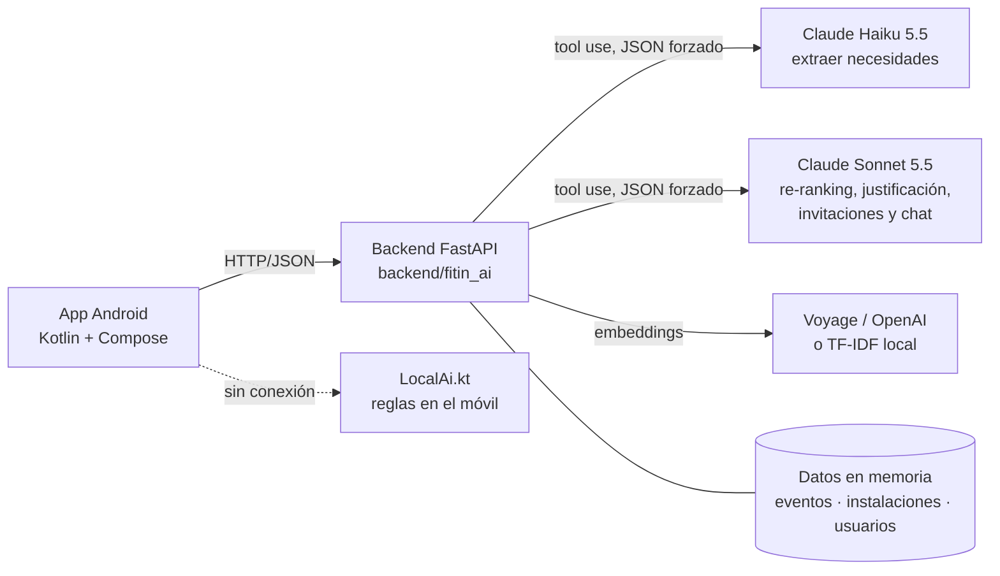

# Fit-In con IA: arquitectura, prompts y cómo hacer la demo

La IA es el motor de la experiencia: entiende lo que la persona escribe con sus palabras, elige **evento + instalación**, explica por qué y, si no hay grupo ideal o falta gente, **busca personas compatibles cerca y les manda una invitación personalizada**.

> Todo dato (instalaciones, personas, reseñas) es de ejemplo. Los nombres de instalaciones son genéricos a propósito.

---

## 1. Arquitectura y stack



| Pieza | Elección | Por qué (hackathon) |
|---|---|---|
| App | **Kotlin + Jetpack Compose** (la que ya teníais) | Cero migración. Sin dependencias nuevas: HTTP con `HttpURLConnection` + `org.json`. |
| Backend | **Python + FastAPI**, un solo proceso | 10 endpoints en un archivo, docs automáticas en `/docs`, tests con `TestClient`. |
| LLM | **Claude Haiku 5.5** (extracción) + **Claude Sonnet 5.5** (razonar y redactar) | Haiku es rápido y barato para el paso que se hace en cada búsqueda; Sonnet para lo que el jurado lee. |
| Salida estructurada | **Tool use con `tool_choice` forzado** + JSON Schema | El modelo *tiene* que devolver el JSON del esquema; el backend además filtra códigos o ids inventados. |
| Embeddings | Voyage AI u OpenAI si hay clave; si no, **TF-IDF local** | Con decenas de eventos y usuarios, numpy en memoria es instantáneo. **No hace falta base vectorial**. |
| Datos | En memoria, generados con fechas relativas a hoy | «Hoy por la tarde» siempre encuentra algo durante la demo. |
| Notificaciones | **Bandeja dentro de la app** + aviso flotante (sondeo cada 20 s) | Fiable en directo. FCM es el siguiente paso (ver §6). |
| Respaldo | Si no hay clave o falla la red: motor local en el servidor **y** en el móvil | La demo no se queda en blanco. Cada respuesta indica qué motor la generó. |

**Para escalar** (decidlo en la presentación, no lo construyáis ahora): Postgres/Supabase + `pgvector` (misma interfaz `embed()`), FCM para push reales y una cola para enviar las invitaciones.

---

## 2. El flujo de IA paso a paso

`POST /api/recommendations` (código: `backend/fitin_ai/engine.py`)

1. **Extracción** (Haiku): texto libre → JSON de necesidades (§3.1). Respaldo: reglas en `local_nlp.py`.
2. **Filtro duro**: fuera los eventos sin plazas o ya pasados. Lo que falta de accesibilidad **se marca, no se esconde** (la persona decide).
3. **Puntuación híbrida** por evento:
   `0,30·deporte + 0,25·necesidades cubiertas + 0,18·horario + 0,10·distancia + 0,07·nivel + 0,10·similitud semántica`
   Las necesidades de la persona se cruzan con las **de la instalación** (sin escalones, grúa, cubierta…) y **de la actividad** (monitor, material, intérprete…).
4. **Re-ranking y justificación** (Sonnet): ordena el top-5 y escribe una razón de ≤ 25 palabras por opción (§3.2).
5. **Smart grouping** (§4):
   - *Completar*: el mejor evento encaja pero le falta gente (pádel necesita 4) → invita a usuarios compatibles cercanos.
   - *Nuevo grupo*: no hay evento ideal → busca la instalación más cercana que cubra **todas** sus necesidades y tenga hueco en su franja, crea un grupo «propuesto» e invita.
   - *Sin instalación*: no hay sitio que cubra lo necesario → se dice claramente (y en el futuro va al panel municipal como demanda no atendida).
6. **Notificaciones** (Sonnet): una invitación personalizada por persona (§3.3), sin duplicados por evento.

Al aceptar invitaciones, cuando el grupo llega al mínimo se avisa a todos con «✅ ¡Grupo completo!».

---

## 3. Prompts y esquemas (salida JSON estructurada)

Los textos completos están en `backend/fitin_ai/llm.py`. Resumen:

### 3.1 Extracción de necesidades: herramienta `registrar_necesidades` (Haiku)

Reglas clave del prompt de sistema:
- **«Se pregunta qué necesitas, nunca qué tienes»**: no se registran diagnósticos. «Voy en silla de ruedas» → `SinEscalones`, `Vestuario`.
- Vocabulario cerrado: los códigos coinciden **exactamente** con los enums `Sport` y `Need` de Kotlin.
- `preferencias_texto` es una frase neutra **sin datos de salud**: es lo que se usa para comparar con otras personas.

```json
{
  "actividad": "Padel | Natacion | Baloncesto | Tenis | Golf | Senderismo | Ciclismo | null",
  "actividad_libre": "string | null",
  "nivel": "iniciacion | intermedio | avanzado | null",
  "cuando": { "dia": "hoy | manana | esta_semana | fin_de_semana | cualquiera",
              "franja": "manana | mediodia | tarde | noche | cualquiera" },
  "zona": "string | null",
  "radio_km": "number | null",
  "necesidades": ["SinEscalones", "Cubierta", "..."],
  "compania": "sola | con_grupo | con_acompanante | indiferente",
  "personas_extra": 0,
  "preferencias_texto": "Pádel nivel intermedio por la tarde en pista cubierta.",
  "confianza": 0.95,
  "aclaracion": "string | null"
}
```

Ejemplo real con *«Busco jugar pádel nivel intermedio hoy por la tarde, necesito pista cubierta y que sea accesible»* → `actividad: Padel`, `nivel: intermedio`, `cuando: {hoy, tarde}`, `necesidades: [SinEscalones, Cubierta]`.

### 3.2 Re-ranking: herramienta `recomendar` (Sonnet)

Entrada: lo extraído + hasta 5 candidatas con `cubre`, `faltan`, `distancia_km`, `plazas_libres`, `faltan_personas_para_minimo` y `score_algoritmo`.
Prioridad indicada al modelo: necesidades cubiertas > deporte > horario > cercanía > nivel > hueco.

```json
{ "ranking": [{ "event_id": "padel_inclusivo", "encaje": 92,
                "razon": "Pista cubierta y sin escalones, hoy a las 18:30 y a 5 km. Solo falta una persona." }],
  "mensaje": "He encontrado tu partido de esta tarde.",
  "necesita_grupo": true }
```

### 3.3 Invitaciones: herramienta `redactar_invitaciones` (Sonnet)

Título ≤ 45 caracteres y mensaje ≤ 140, personalizados con las preferencias de **quien recibe**. Prohibido revelar necesidades o salud de nadie; de quien organiza, solo el nombre de pila. Sin urgencia falsa.

```json
{ "invitaciones": [{ "user_id": "raul", "titulo": "🎾 Pádel cubierto hoy a las 18:30",
                     "mensaje": "Lucía busca una persona más para un partido de nivel medio en el club cubierto. Te pilla cerca y es por la tarde, como te gusta." }] }
```

### 3.4 Chat

Sonnet en texto libre, con los resultados del motor inyectados como contexto. Debe basarse **solo** en esos datos (no inventa actividades). Las tarjetas se pintan debajo del mensaje.

---

## 4. Compatibilidad entre usuarios (smart grouping)

Para un evento E y quien busca U, cada persona C es candidata si:
- ha aceptado ser localizable (`discoverable`; en los datos, Carmen no lo es y nunca se la invita),
- practica el deporte de E,
- **la instalación cubre sus propias necesidades** (si no, no podría ir),
- vive a ≤ 8 km de la instalación (`FITIN_GROUP_RADIUS_KM`),
- su nivel es compatible (como mucho un nivel de diferencia).

Puntuación: `0,45·similitud semántica(preferencias U, preferencias C) + 0,20·nivel + 0,20·disponibilidad en esa franja + 0,15·cercanía`. Umbral 0,45.

A quien organiza se le muestra solo: nombre de pila, % de compatibilidad, distancia aproximada y lo que tenéis en común («También juega pádel · Libre por la tarde»). **Nunca las necesidades de nadie.**

---

## 5. API

| Método | Ruta | Qué hace |
|---|---|---|
| GET | `/api/health` | Motor activo (Claude o local) y embeddings |
| POST | `/api/needs/parse` | Solo extracción |
| POST | `/api/recommendations` | Flujo completo: necesidades → ranking → smart grouping → avisos |
| POST | `/api/chat` | Asistente conversacional con tarjetas |
| GET | `/api/events` · `/api/events/{id}` | Eventos con instalación y plazas |
| POST | `/api/events/{id}/join` | Apuntarse (completa el grupo y avisa si se llega al mínimo) |
| POST | `/api/events` | «Crear actividad»: la IA elige sitio y hora e invita |
| GET | `/api/notifications/{user}` | Bandeja de avisos |
| POST | `/api/notifications/{id}/respond` | Aceptar o rechazar una invitación |
| PUT | `/api/users/{user}/preferences` | Onboarding: guarda las preferencias que extrae la IA |
| POST | `/api/demo/incoming` | Demo: otra persona compatible te busca y te llega la invitación |
| POST | `/api/demo/reset` | Reiniciar datos |

---

## 6. Cómo arrancarlo

**Backend** (Windows): doble clic en `backend/run.bat`, o:
```
cd backend
python -m venv .venv && .venv\Scripts\pip install -r requirements.txt
copy .env.example .env      (y pegad ANTHROPIC_API_KEY=…)
.venv\Scripts\python -m uvicorn fitin_ai.main:app --host 0.0.0.0 --port 8000
```
- Consola de pruebas: http://localhost:8000 · Documentación: http://localhost:8000/docs
- Sin clave funciona igual en **modo local** (reglas + TF-IDF). Con `FITIN_LOCAL=1` se fuerza aunque haya clave (por si el wifi del evento falla).
- Tests: `cd backend && .venv\Scripts\python -m pytest -q` (12 tests, sin red).

**App**: abrid el proyecto en Android Studio y ejecutad `app`.
- En el **emulador** la app ya apunta a `http://10.0.2.2:8000` (el ordenador).
- En un **móvil real** conectado a la misma wifi: Perfil › Servidor de IA › `http://IP-del-portátil:8000` › Conectar. En Windows, `ipconfig` da la IP; puede que tengáis que permitir Python en el firewall.
- Si no llega al servidor, la app usa su motor local y lo indica con la etiqueta «IA sin conexión».

**Push reales (después del hackathon)**: añadir Firebase Cloud Messaging, guardar el token por usuario y llamar a FCM desde `_send_invites` en `engine.py`. La bandeja actual se queda como historial.

---

## 7. Guion de demo (3 minutos)

1. **Bienvenida › Comenzar.** Lucía escribe: *«Busco jugar pádel nivel intermedio hoy por la tarde, necesito pista cubierta y que sea accesible»*.
2. La IA muestra **lo que ha entendido** (chips) y recomienda el **pádel inclusivo de hoy a las 18:30 en el club cubierto**, con la razón y las necesidades cubiertas en verde.
3. Tarjeta **«Completando tu grupo»**: falta 1 persona, ha avisado a Raúl (72 %) y a Luis. Recalcad que Carmen no aparece porque no quiere ser localizable, y que solo se comparte el nombre de pila.
4. **Apuntarme › Con quién › Reservar** → pantalla de celebración.
5. **Lado receptor**: Notificaciones › «Demo: alguien compatible te busca» → aparece el aviso flotante con una invitación redactada para Lucía → «Me apunto».
6. **«+» Crear actividad**: Pádel, mañana por la tarde → la IA elige instalación libre que cubre lo que necesita e invita a gente compatible.
7. **Chat**: *«¿Qué hay para silla de ruedas?»* → respuesta con tarjetas.
8. Cierre: Perfil › Panel del Ayuntamiento.

Con `/api/demo/reset` (o el botón de la consola) se vuelve a empezar.
