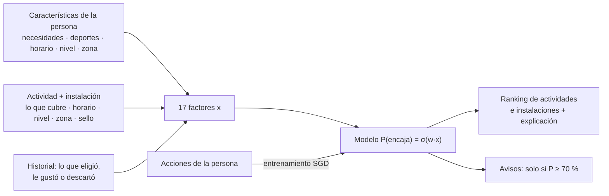

# La IA de Fit-In: un recomendador que aprende dentro del móvil

**Qué hace:** recomienda **actividades e instalaciones** según las **características que pone cada persona** (lo que necesita, sus deportes, horario, nivel y zona). Aprende de lo que hace y le **avisa** cuando aparece algo que encaja con ella.

**Qué no hace:** no llama a ninguna API ni a ningún servidor, no necesita Internet y ningún dato sale del móvil.

> Todos los datos (actividades, instalaciones, personas) son de ejemplo.

---

## 1. Idea en una frase (para el jurado)

> Un modelo de **regresión logística con aprendizaje en línea** cruza 17 factores de la persona y de cada actividad o instalación. Arranca con conocimiento experto y **se reentrena con cada acción**: apuntarse, darle a «me gusta», valorar, abrir o descartar. Así cada persona tiene su propio modelo. Cada recomendación explica **por qué**.



Código: [`app/src/main/java/com/marbellup/fitin/data/Recommender.kt`](app/src/main/java/com/marbellup/fitin/data/Recommender.kt).

---

## 2. Los datos de entrada

**De la persona** (pantalla «Mis preferencias»). Todo se **elige tocando mosaicos**, sin escribir, para que el modelo reciba siempre datos limpios y comparables:

| Característica | Ejemplos |
|---|---|
| Lo que necesita (16 opciones en 5 grupos) | Sin escalones, vestuario adaptado, grúa de piscina, instalación cubierta, lengua de signos, guía, entorno tranquilo, monitor de apoyo, alguien que la acompañe… |
| Deportes que le gustan | Pádel, natación, baloncesto… |
| Horario | Mañanas, mediodía, tardes, noches |
| Nivel | Iniciación, intermedio, avanzado, da igual |
| Zona | Centro, oeste, este, norte |

Se pregunta **qué necesita, nunca qué tiene**: no se recoge ningún diagnóstico.

**De cada actividad e instalación:** lo que cubre el sitio (comprobado: sin escalones, grúa, cubierta…) y la actividad (monitor, material adaptado, intérprete…), día y hora, nivel, zona, sello de verificación, confirmaciones de otras personas, voluntariado y plazas.

**Por qué opciones y no texto libre:** con texto, el modelo dependería de cómo escribe cada persona («accesible», «voy en silla», «sin barreras»…) y podría malinterpretarlo. Con opciones cerradas, cada característica es una variable exacta del modelo. El asistente del chat también funciona con preguntas para tocar («¿Qué hay cerca de mí?», «¿Qué hay para silla de ruedas?», «Quiero un deporte concreto»…).

---

## 3. El modelo

### 3.1 Los 17 factores (x) y su peso inicial (w₀)

| Factor | Cómo se calcula | w₀ |
|---|---|---|
| Cubre tus necesidades | necesidades cubiertas ÷ necesidades | +2,2 |
| Le falta algo que necesitas | nº de necesidades sin cubrir (máx. 3) ÷ 3 | **−2,6** |
| Deporte que te gusta | ¿está entre los que marcó? | +1,2 |
| Parecida a lo que te gustó | similitud del coseno con lo que eligió o valoró bien | +1,0 |
| Parecida a lo que no te gustó | similitud con lo que descartó o valoró mal | −0,8 |
| Deporte que más eliges | proporción de sus elecciones de ese deporte (aprendido) | +1,5 |
| Horario que más eliges | ídem por franja horaria (aprendido) | +1,0 |
| Nivel que más eliges | ídem por nivel (aprendido) | +0,6 |
| En tu horario | ¿coincide con las franjas que marcó? | +0,8 |
| Pronto | cuántos días faltan (0–14) | +0,4 |
| Tu nivel | encaje de nivel | +0,5 |
| Cerca de ti | proximidad entre zonas | +0,6 |
| Sitio verificado | sello del Ayuntamiento (1) o de una asociación (0,7) | +0,4 |
| Bien valorada | log(confirmaciones) | +0,3 |
| Con voluntariado | más si necesita acompañamiento | +0,2 |
| Hora tranquila | hora valle | +0,1 |
| Al grupo le faltas tú | grupo por debajo del mínimo | +0,2 |

El modelo calcula **P(encaja) = σ(w·x)** (sigmoide de la suma ponderada, más un sesgo). Esa probabilidad es el **% de encaje** que se ve en cada tarjeta.

### 3.2 Cómo aprende

Cada acción es un **ejemplo de entrenamiento** con su etiqueta y su peso:

| Acción en la app | Etiqueta | Peso |
|---|---|---|
| Valorar 👍 / 👎 en el calendario | 1 / 0 | 1,2 |
| Apuntarse | 1 | 1,0 |
| «No me interesa» | 0 | 1,0 |
| «Me gusta» / quitarlo | 1 / 0 | 0,7 / 0,3 |
| Abrir / descartar un aviso | 1 / 0 | 0,5 |
| Abrir la ficha (solo la 1.ª vez) | 1 | 0,15 |

Con cada ejemplo hay **un paso de descenso de gradiente** sobre la pérdida logística:

```
w ← w − η · [ peso · (σ(w·x) − etiqueta) · x  +  λ · (w − w₀) ]      η = 0,25   λ = 0,02
```

- **Regularización hacia los pesos expertos** (w₀): aprende tus gustos sin olvidar lo esencial. Por ejemplo, nunca deja de penalizar que a un sitio le falte algo que necesitas.
- **Muestreo negativo:** por cada acción positiva entrena también con una actividad que no eligió, como ejemplo negativo suave (peso × 0,3). Es la técnica estándar en recomendadores con feedback implícito.
- **Personalización por contenido:** los factores «parecida a lo que te gustó» y «deporte / horario / nivel que más eliges» se calculan con el historial de cada persona. Así el modelo descubre gustos que no marcó.

Los pesos y el historial se guardan en el móvil (`Store.kt`) y sobreviven al cerrar la app.

### 3.3 Instalaciones

El mismo modelo puntúa las **instalaciones** de un deporte con los factores del sitio: cobertura de las necesidades físicas, lo que falta, proximidad y sello. Se usa en:
- «Mis preferencias › Ver mis recomendaciones» (sitios para tu deporte).
- «+ Crear actividad»: la IA ordena dónde organizarla y marca la mejor opción.

### 3.4 Explicabilidad

Cada factor aporta **wᵢ·xᵢ** a la puntuación. La app muestra:
- **«Por qué te lo recomiendo»:** las 3 aportaciones positivas mayores, más lo que falta («Ojo: falta grúa de piscina»).
- **«Lo que ha tenido en cuenta la IA»:** en la ficha, los factores con su signo (+ / −).
- **Perfil › «Cómo aprende tu IA»:** el peso de cada factor frente a su valor inicial (▲▼), cuántas acciones ha aprendido y el historial. Ideal para enseñarlo en directo.

---

## 4. Avisos proactivos

- La IA avisa **solo** de actividades con **P ≥ 70 %** que la persona no ha visto, no ha descartado y en las que no está apuntada (`notify/Alerts.kt`).
- **En segundo plano:** WorkManager revisa cada 6 h, aunque la app esté cerrada, y lanza una notificación de Android. Al tocarla se abre la ficha.
- **Al momento:** después de apuntarse o darle a «me gusta», el modelo se reentrena y revisa si ahora hay algo nuevo que encaje: «Como te interesó natación, te puede encajar…».
- Abrir o descartar el aviso **también entrena** el modelo.
- **Demo:** en Avisos o en Perfil, «Demo: el Ayuntamiento publica una actividad». Hay tres preparadas:
  - natación de tarde → encaja (~99 %) → aviso.
  - pádel cubierto → encaja → aviso.
  - ruta costera sin adaptar → **no avisa** y explica por qué (encaje muy bajo: «falta acceso sin escalones…»).

---

## 5. ¿Funciona? Simulación reproducible

`app/src/test/java/com/marbellup/fitin/data/SimulacionAprendizajeTest.kt` (en Android Studio: clic derecho › Run).

- **Personas:** 300 sintéticas con gustos **ocultos** (2 deportes favoritos, horario, nivel). En la app solo declaran sus necesidades y, a veces, uno de sus deportes.
- **Actividades:** cada semana hay 25 disponibles, de un catálogo de 120.
- **Comportamiento:** la app enseña 3 y la persona se apunta a la que más le gusta o descarta la peor.
- **Métrica: acierto@3** = la actividad que de verdad era la mejor para ella está entre las 3 recomendadas.

| Semana | Modelo que aprende | Mismo modelo sin aprender | Al azar |
|---|---|---|---|
| 1 | 58 % | 58 % | 13 % |
| 4 | 73 % | 62 % | 10 % |
| 8 | 82 % | 59 % | 13 % |
| 12 | **84 %** | 58 % | 12 % |

Además, de lo que recomienda en el top-3, el **79 %** cubre todas las necesidades de la persona, cuando entre todas las actividades disponibles solo las cubre el 40 %.

---

## 6. Por qué este enfoque (preguntas típicas del jurado)

- **¿Por qué no una API de IA generativa?** Sin conexión no hay errores de red, costes ni datos personales fuera del móvil, y además es predecible. Para datos de necesidades de personas con discapacidad, la privacidad pesa mucho.
- **¿Por qué regresión logística y no una red neuronal?** Con pocos datos por persona aprende rápido y es **explicable**: cada recomendación se justifica factor a factor. Puede entrenarse en el móvil en microsegundos.
- **¿Y el arranque en frío?** Los pesos expertos dan buenas recomendaciones desde el primer día (58 % frente a 13 % al azar), y el aprendizaje las mejora.
- **¿Cómo escalaría?**
  - Añadir factores colaborativos («a personas con necesidades parecidas les gustó…») agregando datos anónimos.
  - Ajustar w₀ con datos reales del piloto.
  - Pasar a TensorFlow Lite si se quisiera un modelo mayor.

---

## 7. Guion de demo (3 minutos)

1. **Comenzar.** Lucía marca en los mosaicos: *sin escalones, aseo adaptado, cubierta* · *pádel* · *tardes* · *intermedio* · *centro*.
2. **Ver mis recomendaciones:**
   - Pádel inclusivo de hoy a las 18:30 con un 98 %: «Cubre lo que necesitas, es un deporte que te gusta, es en tu horario».
   - Debajo, instalaciones de pádel ordenadas, con lo que cubre cada una.
3. Abre el **pádel del parque** (le falta vestuario y es al aire libre) › **No me interesa**.
4. **Perfil › Cómo aprende tu IA:** se ven el peso «Parecida a lo que no te gustó» y el historial.
5. Apúntate a **natación** y valórala con 👍 en el Calendario. En Inicio, natación sube y aparece «Es el deporte que más eliges».
6. **Avisos › Demo: el Ayuntamiento publica una actividad** (2 o 3 veces):
   - La natación de tarde llega como notificación del móvil.
   - La ruta costera no adaptada no avisa, y se ve por qué.
7. Cierre con la **tabla de la simulación**: del 58 % al 84 % de acierto.

*Para repetir la demo desde cero:* Perfil › Cómo aprende tu IA › **Reiniciar lo aprendido**. También vale desinstalar y reinstalar la app.
