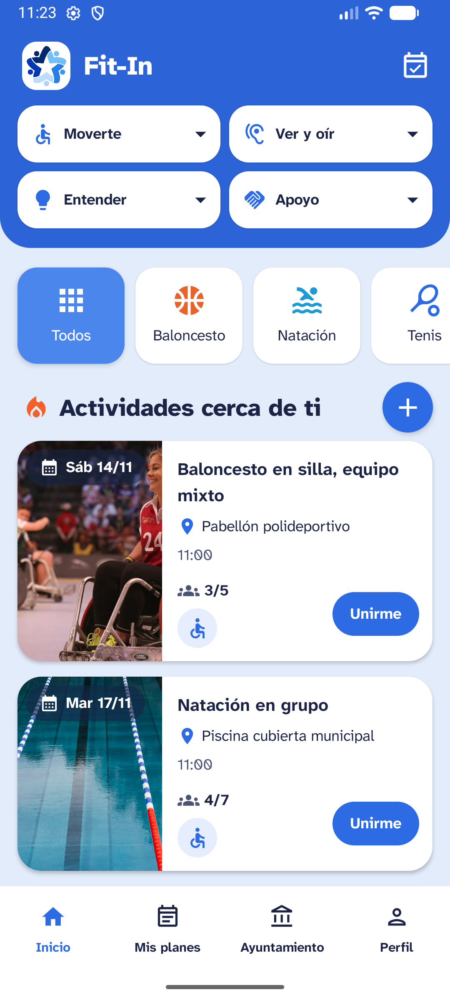
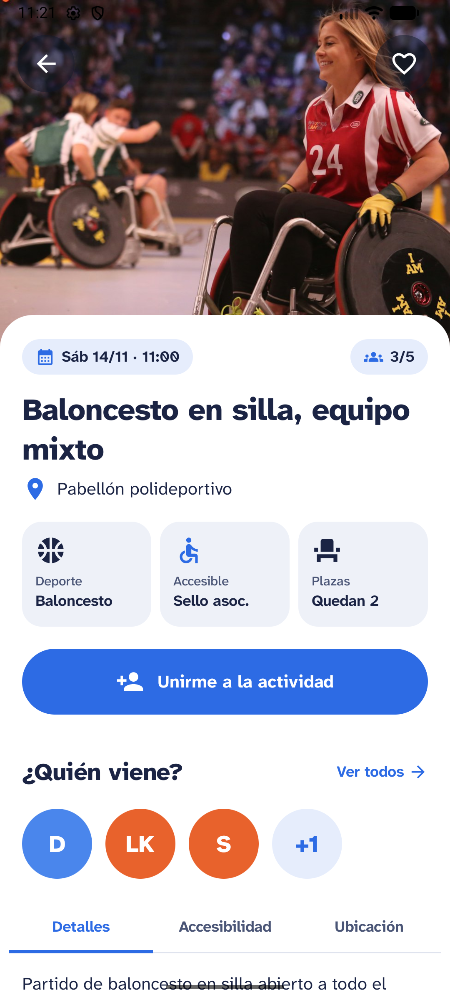
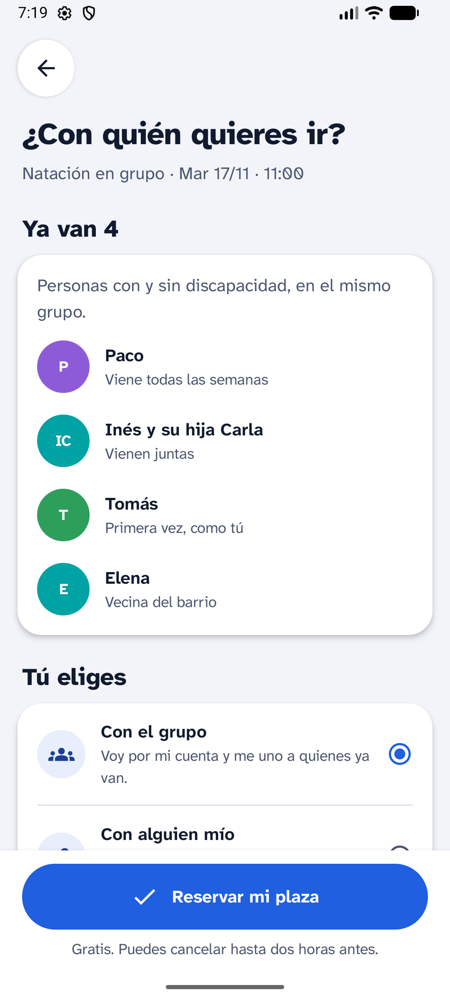
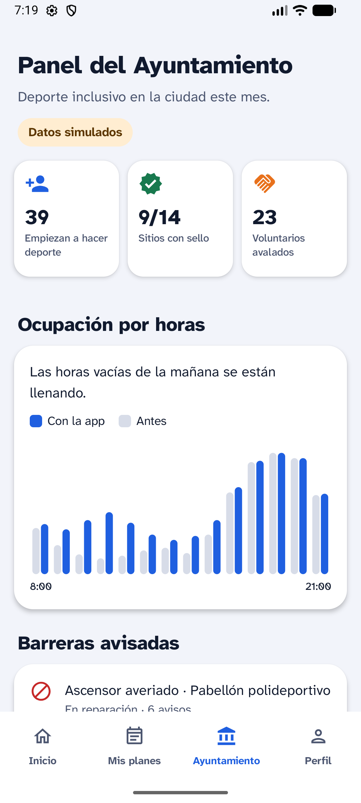

# Fit-In

**Deporte inclusivo en Marbella: actividad, sitio comprobado y compañía. Ahora con IA.**

Versión 2 con rediseño y motor de IA. La versión original, ganadora de MarbellUp 2026, sigue en <a href="https://github.com/javirmmn/marbellup-2026">javirmmn/marbellup-2026</a>.

🏆 **Primer puesto en la hackathon MarbellUp 2026**

---

> *Que ninguna persona con discapacidad en Marbella se quede sin hacer deporte por no tener con quién ni dónde.*

Fit-In empieza preguntándote **qué necesitas, nunca qué tienes**. Con eso te propone una actividad en un sitio cuya accesibilidad ha comprobado alguien (y se dice quién y cuándo) y un grupo con el que ir. Es deporte inclusivo, no separado: personas con y sin discapacidad en el mismo grupo.

  
  
  
  

## Qué hay en este repo

| | |
|---|---|
| 📱&nbsp;**[`app/`](app)** | App Android en Kotlin + Jetpack Compose. Recorre la historia de Lucía: indica sus necesidades, encuentra natación en grupo, ve quién lo ha comprobado, elige con quién ir y reserva. Incluye el **panel del Ayuntamiento** y la opción de crear actividades. |
| 🌐&nbsp;**[`web/`](web)** | `index.html`: la web del proyecto, con un móvil interactivo para probar la app. `presentacion.html`: la presentación que expusimos ante el jurado (se avanza con las flechas o la barra espaciadora). |
| 🎬&nbsp;**[`video/`](video)** | El reel de la historia de Lucía (`fit-in-reel-lucia.mp4`) y su proyecto de edición. |
| 🖼️&nbsp;**[`shots/`](shots)** | Capturas de la app durante su desarrollo. |
| 📄&nbsp;**[`PRODUCT.md`](PRODUCT.md)** | Usuarios, principios y alcance del producto. |

## Novedad: IA que aprende dentro del móvil

La versión 2 trae un rediseño completo (lila, cristal y mascota) y un **recomendador con aprendizaje automático que funciona entero en el móvil**, sin APIs ni Internet:

- La persona marca sus **características** (lo que necesita, deportes, horario, nivel y zona) tocando opciones, sin escribir.
- Un modelo de **regresión logística con aprendizaje en línea** ordena **actividades e instalaciones** según esas características y explica por qué.
- **Aprende** de cada acción: apuntarse, «me gusta», valorar, «no me interesa».
- **Avisa** (notificaciones de Android) cuando aparece algo que encaja al menos un 70 %.
- En una simulación con 300 personas, el acierto pasa del **64 % al 80 %** en 12 semanas.

Además: 14 deportes y más de 20 actividades de ejemplo con portadas distintas, buscador por palabras clave, calendario por semana o mes y «Mis logros» con estadísticas y medallas.

### Traído de la versión de Talent Land

- **«Cuéntanoslo»:** la persona cuenta con sus palabras, **escribiendo o con la voz**, qué necesita. Un **modelo propio** del equipo (regresión logística, unos 570 KB, dentro del móvil y sin internet) propone las necesidades con su «porque dijiste…» y pregunta cuando duda. Nada se guarda sin confirmar. Ver [`modelo/`](modelo).
- **Catálogo de 50 necesidades en 9 grupos** (antes 16).
- **«¿Qué tal fue?»** después de cada actividad: carita y unas palabras (también con la voz). Enseña al recomendador y, si en lo que cuentas aparece una necesidad nueva («había mucho ruido»), Cuac propone añadirla al perfil.
- Fuentes Atkinson Hyperlegible Next en versiones fijas (la negrita no se veía en HyperOS).

Cómo funciona, fórmulas, simulación y guion de demo: **[`ARQUITECTURA-IA.md`](ARQUITECTURA-IA.md)**. Las pantallas anteriores están en [`legacy-ui/`](legacy-ui).

## Lo que es (y lo que no)

Fit-In es un **prototipo para la demo de la hackathon**, no una app terminada:

- ✅ El flujo principal se puede recorrer de principio a fin en el móvil.
- ✅ Diseño cuidado y pensado para la accesibilidad: tipografía Atkinson Hyperlegible, botones grandes y modo oscuro.
- ⚠️ **Todos los datos son de ejemplo**: las actividades, las instalaciones, las personas y las cifras del panel municipal son inventadas. Lo que aprende la IA se guarda solo en el móvil.
- ⚠️ Faltan piezas de una app real: registro, chat, pagos, mapa completo e instalaciones reales del piloto.
- ⚠️ Algunas pantallas son solo maqueta y quedan detalles visuales sin pulir.

## Probarlo

**App:** abre el proyecto en Android Studio y ejecuta el módulo `app` (minSdk 26).

**Web y presentación:** abre `web/index.html` o `web/presentacion.html` en el navegador. No hace falta servidor.

## Créditos

Fotos de Unsplash y Wikimedia Commons; los autores y las licencias están en [`CREDITOS-FOTOS.md`](CREDITOS-FOTOS.md). La tipografía Atkinson Hyperlegible Next tiene licencia [OFL](OFL-AtkinsonHyperlegibleNext.txt).

Hecho con ❤️ en Marbella para MarbellUp 2026 por 
Javier Román Meléndez · Mario Cáceres Morales · Noa Ramos Ruiz · Noelia Sánchez Vilchez · Javier Romeo Enríquez de Salamanca

